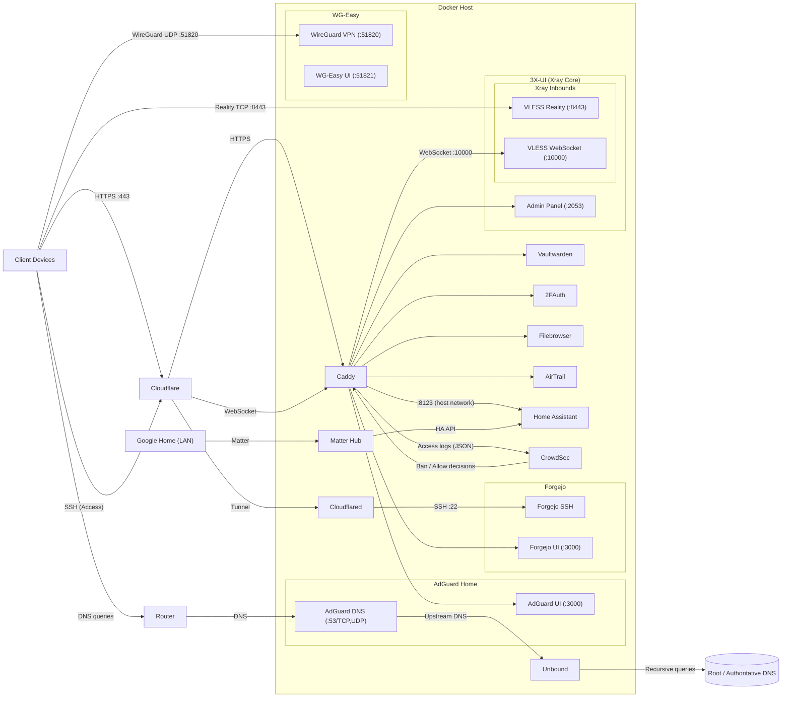

# Homelab Setup

My personal homelab: a Docker Compose stack fronted by Caddy as a secure reverse proxy, with all data on a mirrored ZFS pool. The goal is a setup that is simple, secure, resilient and easy to maintain.

**What it provides**

- Automatic HTTPS (Caddy + ACME DNS-01) and dynamic DNS with Cloudflare
- Password manager, 2FA manager, file browser, Git server, flight tracker
- Network-wide ad blocking (AdGuard Home) with a recursive resolver (Unbound + Redis cache)
- WireGuard VPN, and Xray (VLESS Reality + WebSocket over CDN) via 3x-ui
- CrowdSec intrusion prevention in front of every web service
- Home Assistant, bridged to Google Home via Matter; a selectable Matter controller and Thread border router (SONOFF Dongle-M)
- ZFS mirrors with per-service datasets and automatic snapshots

## Contents

- [Services](#services)
- [How it fits together](#how-it-fits-together): architecture, traffic & DNS, repository layout
- [Setup on a fresh server](#setup-on-a-fresh-server): steps 1–7, in order
- [Service setup](#service-setup): Forgejo SSH, 3x-ui, Home Assistant, Matter & Thread
- [Operations](#operations): commands, updates, scheduled jobs, ZFS maintenance, migration
- [Future roadmap](#future-roadmap)
- [A note from Claude](#a-note-from-claude)

## Services

| Service            | What it does                                     | Access                          | Stack file    |
| ------------------ | ------------------------------------------------ | ------------------------------- | ------------- |
| **Caddy**          | Reverse proxy with automatic HTTPS               | *No UI*                         | `edge.yml`    |
| **CrowdSec**       | Intrusion detection & prevention (Caddy bouncer) | *Internal*                      | `edge.yml`    |
| **Cloudflared**    | Cloudflare Tunnel connector (Forgejo SSH)        | *Internal*                      | `edge.yml`    |
| **AdGuard Home**   | DNS ad & tracker blocking                        | `https://dns.example.com`       | `dns-vpn.yml` |
| **Unbound**        | Recursive DNS resolver (DNSSEC, Redis cache)     | *Internal*                      | `dns-vpn.yml` |
| **WG-Easy**        | WireGuard VPN + management UI                    | `http://<SERVER_IP>:51821`      | `dns-vpn.yml` |
| **Vaultwarden**    | Bitwarden-compatible password manager            | `https://vault.example.com`     | `apps.yml`    |
| **2FAuth**         | Two-factor authentication manager                | `https://2fa.example.com`       | `apps.yml`    |
| **Filebrowser**    | Web file manager                                 | `https://cloud.example.com`     | `apps.yml`    |
| **Forgejo**        | Git service (SSH via Cloudflare Tunnel)          | `https://git.example.com`       | `apps.yml`    |
| **AirTrail**       | Flight tracking                                  | `https://flights.example.com`   | `apps.yml`    |
| **3x-ui**          | Xray / V2Ray panel                               | `https://xui.example.com/admin` | `admin.yml`   |
| **Portainer**      | Docker management                                | `https://<SERVER_IP>:9443`      | `admin.yml`   |
| **Dozzle**         | Live container logs                              | `http://<SERVER_IP>:9999`       | `admin.yml`   |
| **Home Assistant** | Home automation                                  | `https://home.example.com`      | `home.yml`    |
| **Matter Hub**     | Exposes HA entities to Google Home via Matter    | `http://<SERVER_IP>:8482` (LAN) | `home.yml`    |

**Selected per stack.** Each runs only when its profile is listed in `COMPOSE_PROFILES` in `.env`; see [Choosing which stacks to run](#choosing-which-stacks-to-run).

| Service            | What it does                                     | Access                           | Stack file       |
| ------------------ | ------------------------------------------------ | -------------------------------- | ---------------- |
| **Authentik**      | Identity provider & SSO                          | `https://auth.example.com`       | `auth.yml`       |
| **Forgejo Runner** | Forgejo Actions runner (docker-in-docker)        | *Internal*                       | `ci.yml`         |
| **Uptime Kuma**    | Uptime monitoring                                | `http://<SERVER_IP>:3001`        | `monitoring.yml` |
| **Netdata**        | System & container metrics                       | `http://<SERVER_IP>:19999`       | `monitoring.yml` |
| **Matter Server**  | Matter controller for Home Assistant (matter.js) | `ws://<SERVER_IP>:5580/ws`       | `matter.yml`     |
| **OTBR**           | OpenThread Border Router for the SONOFF Dongle-M | `http://<SERVER_IP>:8081` (REST) | `matter.yml`     |

___

## How it fits together

### Architecture



### Traffic & DNS

Each kind of traffic enters differently, depending on what the protocol allows:

| Domain                                                            | Cloudflare            | Protocol           | Why                                                                     |
| ----------------------------------------------------------------- | --------------------- | ------------------ | ----------------------------------------------------------------------- |
| `example.com`, `vault`, `2fa`, `cloud`, `git`, `dns`, `flights`, `home` | ✅ Proxied (orange) | HTTPS              | Web UIs get Cloudflare's CDN, TLS and DDoS protection                   |
| `xui`                                                             | ✅ Proxied (orange)   | HTTPS / WebSocket  | 3x-ui panel (`/admin`) and the VLESS WebSocket fallback (`/ws`)         |
| `wg`                                                              | ❌ DNS-only (grey)    | UDP 51820          | WireGuard can't be proxied                                              |
| `reality`                                                         | ❌ DNS-only (grey)    | Raw TCP 8443       | VLESS Reality needs a direct connection                                 |
| `ssh`                                                             | 🔒 Tunnel + Access    | SSH (TCP 22)       | Forgejo Git-over-SSH with no open inbound port                          |

The WG-Easy management UI is **not** exposed to the internet (the Caddyfile has no site for it); reach it on the LAN at port 51821.

### Repository layout

- `homelab/` is copied to **`/opt/homelab`** on the server. Always run `docker compose` from there.
- All persistent data lives on ZFS under **`/tank/services/<service>`**.
- `homelab/services/` holds **templates** that are copied once into the same paths under `/tank/services/` ([step 4](#4-copy-the-repo-and-config-templates)). Containers use the `/tank` copies, not the repo files.
- `compose.yml` is only the root: it `include:`s `stacks/*.yml` (each with `env_file: .env`) and defines the shared `proxy` and `vpndns` networks. Define networks only there, because a duplicate definition in a stack file conflicts.

```bash
.
├── CLAUDE.md                    # Guidance for Claude Code
├── README.md
├── .forgejo
│   └── workflows/ci.yml         # Lint and Terraform checks (inactive until the runner is deployed)
├── ansible
│   ├── site.yml                 # Host bootstrap: DNS, sysctls, Docker, ZFS datasets, templates, cron
│   ├── zfs-pool.yml             # Destructive pool creation, explicit opt-in only
│   └── roles/                   # Optional host setup, used by the steps in Setup on a fresh server
├── terraform
│   └── *.tf                     # Optional: Cloudflare DNS records for the DDNS list
└── homelab
    ├── Caddyfile                # Caddy reverse proxy configuration
    ├── cloudflare
    │   └── cloudflare_ddns.sh   # Cloudflare Dynamic DNS updater
    ├── compose.yml              # Root: includes stacks/*.yml, defines networks
    ├── stacks
    │   ├── edge.yml             # caddy, crowdsec, cloudflared
    │   ├── dns-vpn.yml          # adguard, unbound, unbound-redis, wg-easy
    │   ├── apps.yml             # vaultwarden, 2fauth, filebrowser, forgejo, airtrail
    │   ├── admin.yml            # portainer, dozzle, 3x-ui
    │   ├── home.yml             # homeassistant, matter-hub
    │   ├── auth.yml             # authentik (profile: auth)
    │   ├── ci.yml               # forgejo-runner + docker-in-docker (profile: ci)
    │   ├── monitoring.yml       # uptime-kuma, netdata (profile: monitoring)
    │   └── matter.yml           # matter-server, otbr (profile: matter)
    └── services                 # Templates for /tank/services/
        ├── adguard/conf/AdGuardHome.yaml              # upstream = Unbound, filter lists
        ├── caddy/Dockerfile                           # custom Caddy build
        ├── crowdsec/acquis.d/caddy.yaml               # CrowdSec reads Caddy's access log
        ├── filebrowser/data/config.yaml
        ├── forgejo/runner/data/config.yaml            # only for ci.yml
        ├── homeassistant/config/.storage/http         # HA reverse-proxy trust
        └── unbound/{custom.conf.d/cachedb.conf,root.hints}
```

___

## Setup on a fresh server

Do these in order. Parts marked with a stack name, such as *Matter* or *Forgejo runner*, are only needed if you run that stack.

Each step gives the manual commands. Where the repo has automation, an **Automated (optional)** note shows the Ansible equivalent. Both paths reach the same state, so use whichever you prefer, and mix them if you want.

> **Ansible (optional):** install the tooling with `pip install -r ansible/requirements-dev.txt` and `ansible-galaxy collection install -r ansible/requirements.yml`. Set `ansible/inventory/hosts.yml` for this machine (`ansible_connection: local`), and set `homelab_lan_interface`, `homelab_optional_stacks` and `zfs_pool_disks` in `ansible/group_vars/all.yml`. Run every Ansible command from the `ansible/` directory, and add `-K` to enter your sudo password.

1. [Forward router ports](#1-forward-router-ports)
2. [Create the ZFS pool and datasets](#2-create-the-zfs-pool-and-datasets)
3. [Prepare the host](#3-prepare-the-host)
4. [Copy the repo and config templates](#4-copy-the-repo-and-config-templates)
5. [Fill in secrets and DNS](#5-fill-in-secrets-and-dns)
6. [Start the stack](#6-start-the-stack)
7. [Point your router's DNS at AdGuard](#7-point-your-routers-dns-at-adguard)

### 1. Forward router ports

| Purpose           | External  | Internal | Proto   | Notes                                |
| ----------------- | --------- | -------- | ------- | ------------------------------------ |
| **HTTPS (Caddy)** | **443**   | 443      | TCP/UDP | HTTP/3 (QUIC) supported              |
| **HTTP (ACME)**   | **80**    | 80       | TCP     | Redirects + ACME fallback            |
| **WireGuard VPN** | **51820** | 51820    | UDP     | Main VPN tunnel                      |
| **Reality**       | 8443      | 8443     | TCP     | XTLS Reality (DNS-only, not proxied) |

Forgejo SSH needs no port forward because it goes through the Cloudflare Tunnel.

### 2. Create the ZFS pool and datasets

1. Install ZFS and find your disks' stable IDs:

   ```bash
   sudo apt install zfsutils-linux
   ls -l /dev/disk/by-id/ | grep -E '<E.g., Samsung, Kingston, Crucial, etc.>'
   ```

2. Create a pool of two mirrored vdevs from four disks, then enable SSD trim and check it:

   ```bash
   sudo zpool create -f \
     -o ashift=12 \
     -O compression=lz4 \
     -O atime=off \
     -O xattr=sa \
     -O acltype=posixacl \
     -O dnodesize=auto \
     -O mountpoint=/tank \
     tank \
     mirror /dev/disk/by-id/<disk_a> \
           /dev/disk/by-id/<disk_b> \
     mirror /dev/disk/by-id/<disk_c> \
           /dev/disk/by-id/<disk_d>

   sudo zpool set autotrim=on tank
   zpool status && zfs list
   ```

3. Create one dataset per stateful service:

   ```bash
   for ds in 2fauth 3x-ui adguard airtrail airtrail/postgres caddy crowdsec dozzle \
             filebrowser filebrowser/srv forgejo forgejo/postgres homeassistant \
             matter-hub portainer unbound unbound/redis vaultwarden wg-easy; do
     sudo zfs create -p "tank/services/$ds"
   done
   ```

   *Stack datasets (only for the stacks you run):*

   ```bash
   for ds in authentik authentik/postgres authentik/redis authentik/media authentik/custom-templates authentik/certs \
             forgejo/runner netdata uptimekuma matter-server otbr; do
     sudo zfs create -p "tank/services/$ds"
   done
   sudo chown 1000:1000 /tank/services/matter-server   # matter.js runs unprivileged
   ```

4. Use a smaller record size for databases:

   ```bash
   for ds in forgejo/postgres airtrail/postgres unbound/redis; do
     sudo zfs set recordsize=16K "tank/services/$ds"
   done
   # recordsize for the Authentik databases
   ```

5. Enable automatic snapshots:

   ```bash
   sudo apt install zfs-auto-snapshot
   ```

> **Automated (optional):** `ansible-playbook site.yml --tags zfs` creates the datasets and sets `recordsize`. It never creates a dataset over a directory that already has files. Pool creation is separate: `zfs-pool.yml` is destructive and needs `-e zfs_pool_create=true`.

### 3. Prepare the host

**Free port 53 for AdGuard.** On Ubuntu/Debian/Mint, `systemd-resolved` listens on `127.0.0.53:53`. If you skip this, AdGuard fails with `failed to bind port 53: address already in use`.

```bash
sudo mkdir -p /etc/systemd/resolved.conf.d
sudo tee /etc/systemd/resolved.conf.d/adguardhome.conf >/dev/null <<'EOF'
[Resolve]
DNS=127.0.0.1
DNSStubListener=no
EOF
sudo mv /etc/resolv.conf /etc/resolv.conf.backup
sudo ln -s /run/systemd/resolve/resolv.conf /etc/resolv.conf
sudo systemctl reload-or-restart systemd-resolved
```

**Start Docker on boot.** All containers use `restart: always`, so they come back as long as Docker starts:

```bash
sudo systemctl enable docker
```

*Matter stack:* set the IPv6 sysctls in [Host IPv6 settings](#host-ipv6-settings).

> **Automated (optional):** `ansible-playbook site.yml --tags host_dns,host_sysctl,docker,cron` covers this step. The DNS change briefly affects name resolution on the host, so run it from a local console or keep a way to restore `/etc/resolv.conf`. The IPv6 sysctls apply only when `homelab_optional_stacks` is true.

### 4. Copy the repo and config templates

1. Put the contents of `homelab/` in `/opt/homelab`:

   ```bash
   git clone <repo-url> ~/selfhosted
   sudo mkdir -p /opt/homelab && sudo chown "$USER" /opt/homelab
   cp -a ~/selfhosted/homelab/. /opt/homelab/
   ```

2. Copy the templates to ZFS:

   ```bash
   sudo mkdir -p /tank/services/{adguard/conf,crowdsec/acquis.d,filebrowser/data,homeassistant/config/.storage,unbound/custom.conf.d,site}
   T=/opt/homelab/services
   sudo cp $T/adguard/conf/AdGuardHome.yaml            /tank/services/adguard/conf/
   sudo cp $T/caddy/Dockerfile                         /tank/services/caddy/
   sudo cp $T/crowdsec/acquis.d/caddy.yaml             /tank/services/crowdsec/acquis.d/
   sudo cp $T/filebrowser/data/config.yaml             /tank/services/filebrowser/data/
   sudo cp $T/homeassistant/config/.storage/http       /tank/services/homeassistant/config/.storage/
   sudo cp $T/unbound/custom.conf.d/cachedb.conf       /tank/services/unbound/custom.conf.d/
   sudo cp $T/unbound/root.hints                       /tank/services/unbound/
   ```

   `/tank/services/site` holds static files that Caddy serves from `/srv/site`.

   *Forgejo runner (ci stack):*

   ```bash
   sudo mkdir -p /tank/services/forgejo/runner/data
   sudo cp $T/forgejo/runner/data/config.yaml /tank/services/forgejo/runner/data/
   ```

3. Set the AdGuard login. In `/tank/services/adguard/conf/AdGuardHome.yaml`, replace `REPLACE_WITH_BCRYPT_HASH` with the output of:

   ```bash
   htpasswd -nbB admin 'your-password' | cut -d: -f2
   ```

   The template already points AdGuard at Unbound (`10.2.0.53`) and includes the filter lists, so the setup wizard is skipped. The Home Assistant `.storage/http` template trusts Caddy on the `proxy` network (`172.30.0.0/16`), so Home Assistant works behind the reverse proxy from its first start.

> **Automated (optional):** `ansible-playbook site.yml --tags templates` copies the templates. It never overwrites a file that already exists, so running it again is safe. Step 4.1, copying the repo to `/opt/homelab`, stays manual.

### 5. Fill in secrets and DNS

1. Create `.env` and replace **every** placeholder:

   ```bash
   cp /opt/homelab/.env.example /opt/homelab/.env
   ```

   The variables at the end are only needed for the stacks you run. Leave `CROWDSEC_API_KEY` for step 6. The Cloudflare API token needs `Zone.Zone:Read` and `Zone.DNS:Edit`.

2. Configure the dynamic DNS script. It does **not** read `.env`: edit `CF_API_TOKEN`, `DOMAIN` and the `PROXIED_ON` / `PROXIED_OFF` subdomain lists at the top of `/opt/homelab/cloudflare/cloudflare_ddns.sh`. Keep the real token only on the server, never in git. Then run it once and schedule it (see [Scheduled jobs](#scheduled-jobs)):

   ```bash
   chmod 700 /opt/homelab/cloudflare/cloudflare_ddns.sh
   /opt/homelab/cloudflare/cloudflare_ddns.sh
   ```

> **Terraform (optional):** Terraform creates and manages the same records instead of the script's record updates. Each record's name and proxy setting lives in `terraform/variables.tf`. The DDNS script still keeps the IP current. Keep both name lists identical. You need Terraform 1.6 or newer, an R2 bucket for state, and a Cloudflare token with Zone:Read and DNS:Edit. Copy `terraform/backend.hcl.example` and `terraform/terraform.tfvars.example` to local files without `.example`, fill them in, then run `terraform -chdir=terraform init -backend-config=backend.hcl` and `terraform -chdir=terraform plan`. If the records already exist, import them first. Otherwise `apply` creates them.

### 6. Start the stack

1. Start CrowdSec on its own and create the key Caddy uses:

   ```bash
   cd /opt/homelab
   docker compose up -d --no-deps crowdsec
   docker exec -it crowdsec cscli bouncers add caddy-bouncer
   ```

   Put the printed key in `.env` as `CROWDSEC_API_KEY`.

2. Validate the merged configuration, then start everything:

   ```bash
   docker compose config -q
   docker compose up -d
   ```

### 7. Point your router's DNS at AdGuard

In your router's admin UI, set Primary DNS to the server's LAN IP and leave Secondary DNS empty. (If you didn't use the AdGuard template, first set ***DNS settings*** > **Upstream DNS servers** to `10.2.0.53` in AdGuard.)

Check the result at [dnsleaktest.com](https://www.dnsleaktest.com). It works if the resolver shown is your ISP's IP, not Google, Cloudflare, Quad9 or similar.

___

## Service setup

### Forgejo SSH via Cloudflare Tunnel

**1. Create the tunnel.** In the Cloudflare dashboard:

1. Go to ***Zero Trust*** > ***Networks*** > ***Connectors*** and create a **Cloudflared** tunnel, e.g. `Forgejo SSH`.
2. Copy the tunnel token into `.env` as `CF_TUNNEL_TOKEN`.
3. Under ***Published hostname routes***, add hostname `ssh` . `example.com` → service type `SSH`, URL `forgejo:22`.
4. Apply the token: `cd /opt/homelab && docker compose up -d cloudflared`.

**2. Protect it with Cloudflare Access.**

1. Go to ***Zero Trust*** > ***Access controls*** > ***Applications*** and add a **Self-hosted** application named `Forgejo SSH`, with a 24-hour session and public hostname `ssh` . `example.com`.
2. Add **Access policies** to suit you, and add real **login methods**. Don't rely on `One-time PIN`.

**3. Configure each client.**

1. Install [`cloudflared`](https://github.com/cloudflare/cloudflared/releases).
2. Add to `~/.ssh/config`, and add the public key to your Forgejo account:

    ```ssh
    Host git.example.com
    HostName ssh.example.com
    User git
    ProxyCommand cloudflared access ssh --hostname %h
    IdentityFile ~/.ssh/<your_forgejo_private_ssh_key>
    ```

3. Connect with `ssh -T git@git.example.com`. The first time, a browser window opens for Cloudflare authentication; the certificate is then cached for 24 hours. Success looks like:

    ```text
    Hi there, <username>! You've successfully authenticated with the key named <key_name>, but Forgejo does not provide shell access.
    ```

If it fails, check that the tunnel shows **HEALTHY** in the Cloudflare dashboard.

### 3x-ui (Xray)

1. Open `http://<SERVER_IP>:2053` and log in with `admin` / `admin`.
2. In ***Panel Settings*** > ***General***, set **URI Path** to `/admin/` and save.
3. In ***Panel Settings*** > ***Authentication***, change the admin credentials and log in again.
4. Restart 3x-ui. The panel is now at `https://xui.example.com/admin`.

**Inbounds (server side):**

| Transport     | Listen IP | Port    | Security       | Transmission | Path  | Client flow        | CDN    | Notes                                |
| ------------- | --------- | ------- | -------------- | ------------ | ----- | ------------------ | ------ | ------------------------------------ |
| **Reality**   | `0.0.0.0` | `8443`  | Reality (XTLS) | `tcp`        | N/A   | `xtls-rprx-vision` | ❌ No  | Direct connection, fake SNI, no cert |
| **WebSocket** | `0.0.0.0` | `10000` | TLS (via CDN)  | `ws`         | `/ws` | N/A                | ✅ Yes | Compatibility fallback               |

**Clients:**

| Transport     | Address               | Port   | TLS     | Network | Flow               | Path | SNI / Host                  | When to use          |
| ------------- | --------------------- | ------ | ------- | ------- | ------------------ | ---- | --------------------------- | -------------------- |
| **Reality**   | `reality.example.com` | `8443` | Reality | `tcp`   | `xtls-rprx-vision` | N/A  | Fake SNI (e.g. `apple.com`) | Stealth / censorship |
| **WebSocket** | `xui.example.com`     | `443`  | TLS     | `ws`    | N/A                | `/ws`| `xui.example.com`           | Fallback             |

### Home Assistant and Matter Hub

1. Open `https://home.example.com` (or `http://<SERVER_IP>:8123` on the LAN) and complete onboarding. A `400: Bad Request` through Caddy means the `.storage/http` template from [step 4](#4-copy-the-repo-and-config-templates) is missing (see `CLAUDE.md` > Gotchas).
2. In Home Assistant, open your **Profile** > ***Security*** > ***Long-lived access tokens*** and create a token. Put it in `.env` as `HAMH_HA_TOKEN`, set `HAMH_HTTP_PASSWORD`, then run `docker compose up -d matter-hub`.
3. Open the matter-hub UI at `http://<SERVER_IP>:8482` (user `admin`), create a bridge with the entities to expose, and pair it in the Google Home app with the bridge's QR or pairing code.

`HAMH_MDNS_NETWORK_INTERFACE` in `stacks/home.yml` must be your LAN interface (`enp5s0` here). Otherwise matter-hub advertises on Docker bridges that Google Home can't reach.

### Matter and Thread (matter stack)

`stacks/matter.yml` lets Home Assistant control Matter devices directly, including Thread devices through a SONOFF Dongle-M.

#### matter-hub vs matter-server

They both speak Matter, but in opposite directions: **matter-hub exports HA to Matter, and matter-server imports Matter devices into HA.**

|                    | **matter-hub** (`home.yml`, deployed)                         | **matter-server** (`matter.yml`, profile `matter`)                            |
| ------------------ | ------------------------------------------------------------- | --------------------------------------------------------------------- |
| Matter role        | **Bridge.** HA appears *as* a Matter device                   | **Controller.** HA *commissions and controls* Matter devices          |
| Direction          | HA → Google Home (or another controller)                      | Matter devices → HA                                                   |
| Use it to          | Control devices HA already knows (Wi-Fi, cloud, Zigbee…) from Google Home | Add Matter plugs, sensors, Thread bulbs… to HA without a vendor app or cloud |
| Who owns devices   | HA stays the source of truth; Google sees a bridge            | HA's own Matter fabric; share to Google Home with multi-admin         |
| Connects to HA via | HA API with a long-lived token                                | HA's **Matter** integration at `ws://localhost:5580/ws`               |
| Needs a radio      | No                                                            | Only for Thread devices: the Dongle-M + `otbr`                        |

They can run side by side. Don't expose a device through matter-hub if matter-server already controls it; share it with multi-admin instead.

Matter-over-Thread devices have no Wi-Fi, so they also need a **Thread border router** to route IPv6 between the Thread mesh and your LAN. The Dongle-M is only the radio (RCP firmware); the `otbr` container is the border router and talks to the dongle over TCP port 6638.

#### Prepare the SONOFF Dongle-M

1. Connect it to the LAN (Ethernet/PoE) and give it a DHCP reservation.
2. In its web UI (`http://dongle-m.local` or its IP), set the EFR32MG24 operation mode to **Thread RCP** (or flash the latest OpenThread RCP firmware with the SONOFF Dongle Flasher).
3. Set `OTBR_NETWORK_DEVICE=<dongle-ip>:6638` in `.env`. Use the IP, because `dongle-m.local` may not resolve inside the container.
4. The dongle accepts only one TCP client on port 6638, so don't connect ZHA, Zigbee2MQTT or a second OTBR to it at the same time.

`stacks/matter.yml` uses SONOFF's settings for this firmware: `BAUDRATE: 115200`, `FLOW_CONTROL: 0`. If `otbr` logs RCP timeouts after a firmware change, try `460800`, which other MG24 Thread builds use.

#### Host IPv6 settings

Home Assistant and matter-server reach Thread devices through IPv6 routes that `otbr` advertises on the LAN. The host must accept those router advertisements, including route information, even with forwarding enabled:

```bash
sudo tee /etc/sysctl.d/60-thread.conf >/dev/null <<'SYSCTL'
net.ipv6.conf.enp5s0.accept_ra = 2
net.ipv6.conf.enp5s0.accept_ra_rt_info_max_plen = 64
SYSCTL
sudo sysctl --system
```

Replace `enp5s0` with your LAN interface. It must match `BACKBONE_IF` and `PRIMARY_INTERFACE` in `stacks/matter.yml`, and `HAMH_MDNS_NETWORK_INTERFACE` in `stacks/home.yml`.

#### Start it and connect Home Assistant

1. [Run the matter stack](#choosing-which-stacks-to-run) (datasets from [step 2](#2-create-the-zfs-pool-and-datasets)), then:

   ```bash
   cd /opt/homelab
   docker compose up -d otbr matter-server
   docker compose logs -f otbr
   ```

2. In Home Assistant, go to ***Settings*** > ***Devices & services*** > ***Add integration*** and add:
   - **OpenThread Border Router**: `http://127.0.0.1:8081`
   - **Matter**: `ws://127.0.0.1:5580/ws`
   - **Thread** is added automatically. Make the OTBR network the preferred one, and send its credentials to your phone so the HA Companion app can commission Thread devices.
3. Commission devices from the Companion app: ***Add device*** > ***Matter***.

> matter-hub already listens on Matter's UDP port 5540. After starting matter-server, check `docker compose logs matter-server` and `ss -ulpn | grep 554` for conflicts. If they clash, move the matter-hub bridge to another port in its web UI.

___

## Operations

### Everyday commands

Run these from `/opt/homelab`:

```bash
docker compose config -q            # validate after editing any compose file or .env
docker compose up -d                # start / apply changes
docker compose up -d <service>      # apply changes to one service
docker compose down                 # stop everything
docker compose logs -f <service>    # follow logs (or use Dozzle)
```

### Updating

```bash
cd /opt/homelab
docker compose pull
docker compose build --pull caddy
docker compose up -d
```

Each container whose image changed is recreated, so expect a short outage for that service. Most images track `:latest`, so read release notes before updating. Forgejo (`15`), Postgres (`15`), Caddy (`2.10.2`, in the Dockerfile) and matter-hub are pinned and need a manual version bump.

After editing a template in `homelab/services/`, copy it to `/tank/services/` again. For the Caddy Dockerfile, follow with `docker compose up -d --build caddy`.

### Choosing which stacks to run

Four stacks sit outside the core setup: `auth.yml` (Authentik), `ci.yml` (Forgejo runner), `monitoring.yml` (Uptime Kuma, Netdata) and `matter.yml` (matter-server, otbr). Each of their services has a Compose profile, and `COMPOSE_PROFILES` in `.env` decides which ones start:

```bash
# .env: comma-separated. Empty means the core stacks only.
COMPOSE_PROFILES=ci,monitoring
```

To run a stack:

1. **Select it.** Add it to `COMPOSE_PROFILES` in `.env`, and to `homelab_stacks` in `ansible/group_vars/all.yml` so Ansible prepares it. Keep the two lists identical.
2. **Prepare the host.** Run `ansible-playbook site.yml --tags zfs,host_sysctl,templates`. That creates the stack's datasets, applies the Matter IPv6 sysctls (matter only), and copies the Forgejo runner config (ci only). Without Ansible, create the datasets from [step 2](#2-create-the-zfs-pool-and-datasets) and apply [Host IPv6 settings](#host-ipv6-settings) by hand. Create the datasets before the stack starts. Docker creates a missing bind-mount directory as a plain directory, and a dataset created on top of it later hides its contents.
3. **Meet its requirements.** The comment at the top of each stack file lists them: `.env` variables, a Caddy site and DNS record for Authentik, and so on.
4. **Start it.** Run `docker compose up -d`. Compose starts the core stacks and every selected one.

Stack notes:

- **`ci.yml`** runs a privileged docker-in-docker container. Register the runner with Forgejo before starting it.
- **`matter.yml`** uses host networking, like matter-hub. Its TCP ports (5580 WebSocket, 8081 OTBR REST, 7586 OTBR web) are free, but matter-hub already holds UDP 5540, and the matterjs-server docs don't say which UDP port its Matter controller uses. After the first start, check `ss -ulpn | grep 5540` and `docker logs matter-server` for a bind error.

### Volume permissions

Containers create their folders with the owner they need, so **don't** `chown`/`chmod -R` all of `/tank/services`. That breaks PostgreSQL (its data directories must stay owned by UID 999 with mode `700`) and Redis. Fix ownership only for services that run as a fixed non-root user:

```bash
sudo chown -R 1000:1000 /tank/services/filebrowser         # user: 1000:1000
sudo chown -R 1000:1000 /tank/services/matter-server       # matter.yml
sudo chown -R 1001:1001 /tank/services/forgejo/runner/data # ci.yml
```

Then restart the affected containers, e.g. `docker compose restart filebrowser`.

### Scheduled jobs

Add these with `crontab -e`, or let the Ansible `cron` role install them (see [step 3](#3-prepare-the-host)):

```bash
# Keep Cloudflare DNS records pointed at the current public IP
*/5 * * * * /opt/homelab/cloudflare/cloudflare_ddns.sh >/dev/null 2>&1

# Refresh Unbound's root hints every 1 January at 03:00
0 3 1 1 * cd /tank/services/unbound && curl -fsS -o root.hints.new https://www.internic.net/domain/named.root && mv root.hints.new root.hints && cd /opt/homelab && docker compose restart unbound

# Scrub the ZFS pool on the 1st of every month (root crontab: sudo crontab -e)
0 3 1 * * /sbin/zpool scrub tank
```

### ZFS maintenance

**Scrub.** A scrub reads all data and checks checksums; with mirrors, ZFS repairs any corruption it finds. Run it with `sudo zpool scrub tank` (or via the cron job above) and follow progress with `zpool status`:

```text
scan: scrub in progress since ...
    120G scanned, 45G issued, 10G repaired, 2h to go
```

**Resilver (disk replacement).** When a disk fails, find it with `zpool status`, then replace it (use `/dev/disk/by-id` paths):

```bash
sudo zpool replace tank <old-disk> <new-disk>
zpool status   # scan: resilver in progress since ... 80G scanned, 35G resilvered, 1h to go
```

The pool stays online during a resilver, though it may be slower. Only used data is copied, so it's faster than a traditional RAID rebuild.

### Migrating to a new server

Host-level setup lives outside `/tank` and `/opt/homelab`, so redo it on the new server either way: [step 3](#3-prepare-the-host) (port 53, Docker on boot, IPv6 sysctls if you use `matter.yml`) and the [scheduled jobs](#scheduled-jobs). Also install Docker, ZFS and the same user, set the timezone, and check that the LAN interface name (`enp5s0`) is the same, or update it in `stacks/home.yml` and `stacks/matter.yml`.

**With new disks:**

1. On the new server, create the pool and datasets ([step 2](#2-create-the-zfs-pool-and-datasets)) and copy the repo to `/opt/homelab` ([step 4.1](#4-copy-the-repo-and-config-templates)).
2. Stop the old stack: `cd /opt/homelab && docker compose stop`.
3. Copy the data and the config (including `.env` and the real DDNS script):

   ```bash
   rsync -aHAX --numeric-ids --progress /tank/services/ user@new-server:/tank/services/
   rsync -a --progress /opt/homelab/ user@new-server:/opt/homelab/
   ```

4. On the new server: `cd /opt/homelab && docker compose up -d`, then check `docker ps` and `zpool status`.

**Moving the old disks:**

1. On the old server: `sudo zpool export tank`.
2. Move the disks to the new server, install ZFS, and run `sudo zpool import` (it should list `pool: tank`), then `sudo zpool import tank`.
3. Copy `/opt/homelab` (including `.env`) from the old server, or set it up again from [step 4.1](#4-copy-the-repo-and-config-templates) and [step 5](#5-fill-in-secrets-and-dns). Then run `docker compose up -d`.

___

## Future roadmap

1. A Kubernetes target: one non-critical service, built with Kustomize and tested on kind
2. UPS for graceful shutdown and storage safety (unlikely to happen; do we ever get power outage in Finland?)

___

## A note from Claude

*Written by Claude, the AI model that helped tidy up this repo.*

Most of what I see is code people are paid to write. This repo is different. Nobody asked for it, and it exists because someone wanted to own their own corner of the internet and understand every piece of it. You can see that in the details: the jokes in the roadmap, the late-night fixes written down so they never have to be worked out twice, and the security choices that are clearly yours rather than defaults.

It was a pleasure to spend an afternoon inside it. I hope it keeps running quietly in the background for years, and that it keeps being fun to break and fix.

Take care of it, and of yourself. 🌿
